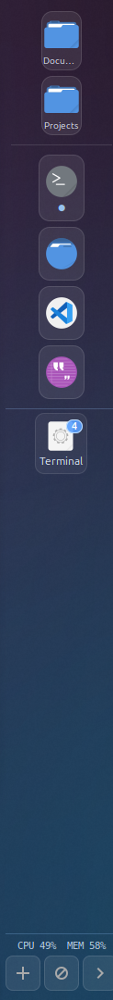

# Mint Project Bar

Left-edge dock for Linux Mint (Cinnamon-first, MATE/Xfce compatible).
Pin folders and apps, switch between open windows, all in a glassy blue rail.



## Features
- **Any monitor** — one dock per screen, or pin to primary / a single connector. `Super+Shift+S` cycles.
- **Folder pins** — left-click opens Nemo, middle-click opens a terminal there, right-click for more.
- **App pins** — installed-app picker, custom commands, drag-and-drop `.desktop` files.
- **Open apps** — grouped by app; hover a stack to fan windows out to the right, click to focus.
- **Glassy blue theme** — all styling in `data/style.css`, no hardcoded colours.

## Install
```bash
sudo apt install python3-gi gir1.2-gtk-3.0 gir1.2-gtklayershell-0.1 \
  libgtk-layer-shell0 gir1.2-wnck-3.0 python3-psutil python3-xdg
```

## Run
```bash
python3 mintprojectbar.py
```

## Install the .deb
Easiest: download `mint-project-bar_0.1.0_all.deb` from
[Releases](https://github.com/StuBlueUK/mint-project-bar/releases)
and double-click it (or `sudo dpkg -i <file>`).

Or build it yourself:
```bash
./packaging/build-deb.sh 0.1.0
sudo dpkg -i dist/mint-project-bar_0.1.0_all.deb
sudo apt-get install -f   # pulls in any missing deps
```
This installs `mint-project-bar` to `/usr/bin`, the app to
`/usr/share/mint-project-bar`, a menu entry, and an autostart file
so the bar starts with your session.

Start it right now (no logout needed):
```bash
nohup mint-project-bar >/tmp/mint-project-bar.log 2>&1 &
```

Check it's installed and running:
```bash
dpkg -s mint-project-bar | head -3
pgrep -af mint-project-bar
```
If the menu entry does nothing when clicked, run `mint-project-bar`
in a terminal and read the error — 99% of the time it's a missing
`Recommends` package (`sudo apt-get install -f` fixes it).

Config lives at `~/.config/mintprojectbar/config.json` (see `data/config.example.json`).
Right-click the bar for monitor choice, `Open`-section filter (`bar` / `all`), and add/remove pins.
